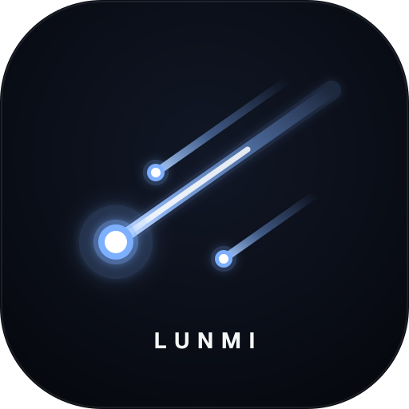
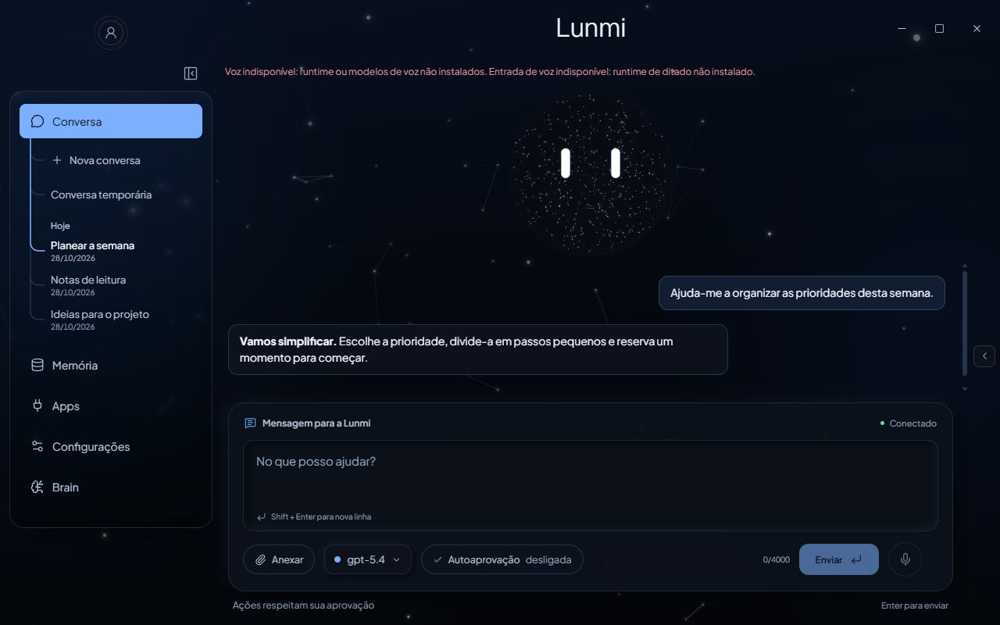
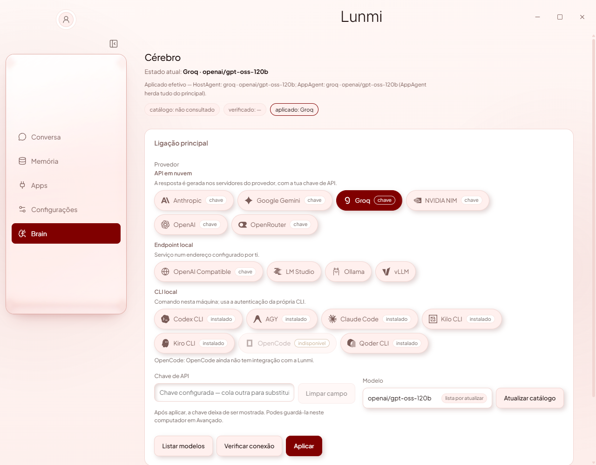
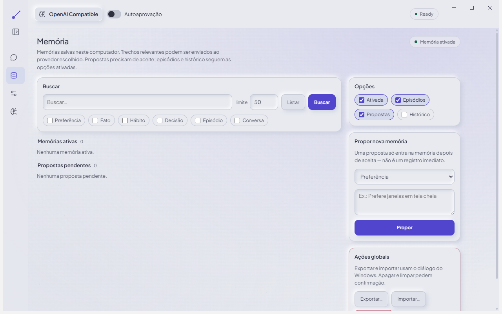

<div align="center">



# Lunmi

**Uma assistente de IA para Windows que conversa contigo e executa tarefas no computador.**

[**Descarregar Alpha 11 · Windows x64 · ~330 MB**](https://github.com/MateusCosta888/Lunmi/releases/download/v0.1.0-alpha.11/Lunmi-0.1.0-alpha.11-Setup.exe)

[Notas da versão](https://github.com/MateusCosta888/Lunmi/releases/tag/v0.1.0-alpha.11) · [Instalar](#instalar) · [Documentação](docs/README.md) · [Contribuir](CONTRIBUTING.md)

[](https://github.com/MateusCosta888/Lunmi/actions/workflows/checks.yml)

</div>

A Lunmi junta um chat de IA com ferramentas para agir no Windows. Podes pedir-lhe para abrir um programa, criar uma pasta, consultar páginas web ou recordar uma preferência. O modelo de IA é escolhido por ti, no painel **Brain**.

<p align="center">
  
</p>

> **Em fase alpha.** A versão publicada é a 0.1.0-alpha.11. Começa com tarefas pequenas e ficheiros de teste. O instalador ainda não tem certificado de editor do Windows.

## Tarefas no Windows

O **Computer Use** permite passar de uma pergunta a uma ação no mesmo chat. Não é preciso escolher um modo: «Como crio uma pasta?» pede uma explicação; «Cria uma pasta chamada Teste Lunmi no ambiente de trabalho» pede uma operação.

Podes começar por pedidos como:

- «Abre o Bloco de Notas.»
- «Cria uma pasta chamada Teste Lunmi no ambiente de trabalho.»
- «Abre as definições de Bluetooth.»

A execução combina ferramentas Windows da Lunmi com os agentes do [Microsoft UFO²](https://github.com/microsoft/UFO), que identificam janelas e interagem com os controlos das aplicações. A Lunmi procura verificar o resultado; quando não o consegue confirmar, indica essa limitação. Nem todas as aplicações expõem controlos utilizáveis, e o modelo também pode interpretar mal o pedido.

Mantém a sessão do Windows aberta e desbloqueada. Lê os pedidos de confirmação e usa **Parar** para cancelar. A **Autoaprovação** altera as confirmações das tarefas seguintes; não elimina a aprovação manual do envio de emails. Uma tarefa interrompida não é repetida automaticamente ao reiniciar.

O cartão com os detalhes do resultado está oculto por defeito. Podes ativar **Mostrar resultado da tarefa no chat** nas configurações.

<!-- Demonstração pendente: gravação real da versão publicada, com pedido, confirmação quando aplicável e resultado observado. Não ligar um vídeo antes de existir. -->

## Instalar

1. Descarrega o [setup da Alpha 11](https://github.com/MateusCosta888/Lunmi/releases/download/v0.1.0-alpha.11/Lunmi-0.1.0-alpha.11-Setup.exe) para **Windows 10 ou 11, x64**. São cerca de **330 MB**: inclui Python e o runtime de áudio. A voz (~400 MB) e o ditado (~1,6 GB) transferem-se depois, só se aceitares.
2. Executa o setup. O destino predefinido é `%LOCALAPPDATA%\Programs\Lunmi`. Não precisas de instalar Python, Node.js ou Git à parte.
3. Abre a Lunmi e segue a introdução para ligar um Brain. Escolhe **Groq**, com a tua chave de API, ou **Kiro CLI**, com a tua conta. A introdução pode instalar o Kiro; este percurso exige **Windows 11**. Também podes configurar outro provedor mais tarde no painel Brain.

O Windows pode mostrar um aviso de editor desconhecido. Confirma que obtiveste o ficheiro nesta release e lê o aviso antes de continuar. A assinatura usada pelo atualizador não substitui o certificado de editor do executável.

### Escolher o modelo de IA

O Brain é a ligação ao modelo que interpreta os pedidos e gera as respostas. Podes usar APIs como OpenAI, Anthropic, Gemini ou Groq; CLIs compatíveis, como Kiro CLI e Codex CLI; ou um serviço local, como Ollama ou LM Studio, instalado por ti. Uma CLI instalada no computador pode continuar a enviar pedidos para a cloud.

O download da Lunmi é gratuito, mas **não inclui um modelo de conversação, chaves nem créditos de IA**. Os custos e as quotas dependem da conta e do provedor. O plano gratuito do Groq tem [limites por modelo, minuto e dia](https://console.groq.com/docs/rate-limits); não corresponde a um número fixo de pesquisas. O Kiro também está sujeito às condições da tua conta.

<details>
<summary>Ver o painel Brain</summary>



Os provedores aparecem agrupados por tipo. O campo de chave só surge quando é necessário. O catálogo de modelos depende do provedor e do teu acesso.

</details>

### Atualizar

Na aplicação instalada, as novas releases são descarregadas em segundo plano. Em **Configurações → Atualizações**, escolhe **Reiniciar e atualizar** quando não houver uma tarefa ou voz em curso. Guarda os rascunhos antes de reiniciar. Os dados pessoais ficam fora da pasta do programa.

O atualizador pode descarregar apenas os blocos alterados, mas recorre ao setup completo quando necessário. A partir da Alpha 6, os componentes de Python e voz só voltam a ser extraídos quando mudam. Para atualizar versões anteriores ou resolver uma falha, consulta o [guia de atualizações](docs/UPDATES.md).

## Na conversa e no ambiente de trabalho

### Pesquisa web

Com a pesquisa ativada, o Brain decide quando consultar informação externa. A pesquisa integrada usa **Free Search MCP**, lê páginas e apresenta fontes junto da resposta. Quando o Brain dispõe de pesquisa nativa compatível, podes escolher essa origem ou o modo automático nas definições. Isto não equivale a controlar um navegador completo.

Uma fonte citada não garante que a resposta esteja correta ou atual. Páginas inacessíveis, fontes antigas e quotas do provedor podem impedir a confirmação. A aplicação distingue uma resposta verificada de uma resposta limitada a excertos ou não verificada.

### Memória e histórico

Podes pedir «Lembra que prefiro respostas curtas» ou editar diretamente o texto no painel **Memória**. As opções **Usar memória** e **Aprender com as conversas** controlam a utilização e a aprendizagem. Também podes consultar, exportar ou apagar os dados.

O **histórico de conversas** é separado: guarda novas conversas neste computador e permite retomá-las, renomeá-las ou apagá-las pela lateral. Nas definições, podes desligar a gravação, escolher a conversa de arranque ou usar uma conversa temporária. Apagar o histórico não apaga a memória pessoal.

<details>
<summary>Ver o editor de memória</summary>



A captura mostra a memória pessoal; o histórico de conversas fica na barra lateral de Conversa.

</details>

### Voz, ditado e Lunmi Node

A voz e o ditado funcionam localmente pela **CPU, sem exigir NVIDIA**, e são opcionais. O setup inclui os modelos; não há escuta contínua. O botão do microfone permite rever a transcrição antes de enviar. O atalho de ditado envia ao largar a tecla — confirma esse comportamento antes de o ativar. A transcrição pode ser lenta em alguns computadores.

O **Lunmi Node** mantém um mini chat num canto do ecrã quando a aplicação fica em segundo plano. Partilha a conversa com a janela principal e encaminha para ela as confirmações. Inclui reproduzir, pausar, anterior e seguinte quando o leitor multimédia expõe esses controlos ao Windows. Durante uma tarefa, o Node fica passivo para não interferir com a automação; a bandeja permite voltar à janela principal.

<!-- Falta uma captura pública do Node com mini chat e leitor multimédia, sem dados pessoais. -->

### Gmail e outros recursos

A integração **experimental com Gmail**, através da tua conta Composio, permite pesquisar, ler e preparar emails. O envio exige rever e aprovar a mensagem, mesmo com Autoaprovação ligada. A ligação e a leitura foram ensaiadas numa conta de testes; o envio foi validado apenas com simulações. [Como ligar o Gmail](docs/GETTING_STARTED.md#ligar-gmail).

O chat também aceita anexos de texto e código UTF-8. Há três temas, um perfil local com nome e fotografia e a opção **Reduzir animações**. As capturas deste README são da Alpha 6, com um perfil de demonstração.

## Privacidade e limites

As conversas e a memória são guardadas localmente, em bases **SQLite separadas**. Podes gerir esses dados na aplicação. **Quando usas um Brain cloud, os pedidos, o contexto necessário e observações das tarefas podem ser enviados para esse provedor.** A pesquisa web e o Gmail também contactam serviços externos.

As chaves guardadas pela interface usam a proteção do Windows. O ficheiro `.env`, se utilizado, é texto simples e deve ser protegido. Não publiques bases de dados, exportações, credenciais ou logs com dados pessoais. [Memória e controlo dos dados](docs/MEMORY.md) · [Segurança](SECURITY.md).

A Alpha 11 não foi validada em todos os ambientes. A instalação num PC limpo ainda está a ser ensaiada; faltam cobertura de Windows 10, vários monitores e escalas, e testes do leitor do Node com aplicações como Spotify e browsers. Voz e ditado continuam experimentais e dependem dos dispositivos de áudio. Não há versão para macOS ou Linux. Os avisos conhecidos das dependências estão documentados em [SECURITY.md](SECURITY.md#dependências-upstream).

## Para programadores

A interface usa **Electron, React e TypeScript**. Uma bridge liga-a ao backend **Python**, que gere o Brain, a memória SQLite e a execução por ferramentas Windows, UI Automation e UFO². Autorização, cancelamento e verificação ficam no backend. A [arquitetura](docs/ARCHITECTURE.md) descreve estas ligações e os diretórios do projeto.

<a id="rodar-pelo-código-fonte"></a>

### Executar pelo código-fonte

Precisas de Windows, **Python 3.11, Node.js 24 LTS, npm e Git**, além de acesso a um Brain. No PowerShell:

```powershell
git clone https://github.com/MateusCosta888/Lunmi.git
cd Lunmi
py -3.11 -m venv .venv
.\.venv\Scripts\python.exe -m pip install -r requirements.lock
.\.venv\Scripts\python.exe install_ufo.py
cd desktop
npm ci --include=dev
npm run build
cd ..
.\run.bat
```

A instalação precisa de internet. `install_ufo.py` obtém e verifica a revisão fixada em [`ufo.lock.json`](ufo.lock.json). O launcher depende deste checkout; não é uma versão portátil. Pelo código-fonte, os recursos de voz não vêm incluídos e o atualizador está desligado. A ausência de voz não impede o chat.

Para usar variáveis de ambiente, copia [`.env.example`](.env.example) para `.env`; os valores explícitos têm prioridade sobre os da interface. Os [primeiros passos](docs/GETTING_STARTED.md) explicam o ambiente, os anexos e a resolução de problemas.

### Testar e contribuir

Na raiz do projeto, com as dependências instaladas:

```powershell
.\.venv\Scripts\python.exe -m pip install -r requirements-dev.txt
.\.venv\Scripts\python.exe -m pytest -q
.\.venv\Scripts\python.exe -m mypy
.\.venv\Scripts\python.exe -m ruff check app tests
cd desktop
npm run typecheck
npm test
npm run build
```

Os testes automatizados não certificam operações em aplicações reais. Ensaios com modelos, contas ou controlo do computador precisam de um ambiente e efeitos definidos. Consulta [CONTRIBUTING.md](CONTRIBUTING.md) antes de propor alterações e o [índice da documentação](docs/README.md) para aprofundar o projeto.

## Créditos e licença

A Lunmi utiliza [Microsoft UFO²](https://github.com/microsoft/UFO), Electron, React, Supertonic, Whisper e outros projetos. As atribuições e condições aplicáveis estão em [THIRD_PARTY_NOTICES.md](THIRD_PARTY_NOTICES.md).

**O código próprio da Lunmi ainda não tem licença definida.** A disponibilidade do código no GitHub não concede as permissões de uma licença open source. As licenças das dependências continuam a aplicar-se aos respetivos componentes.
