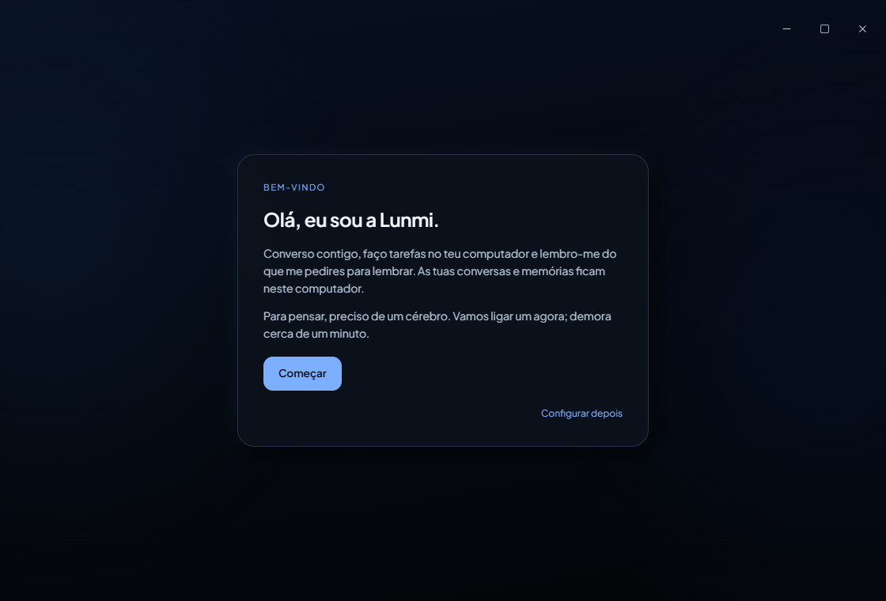
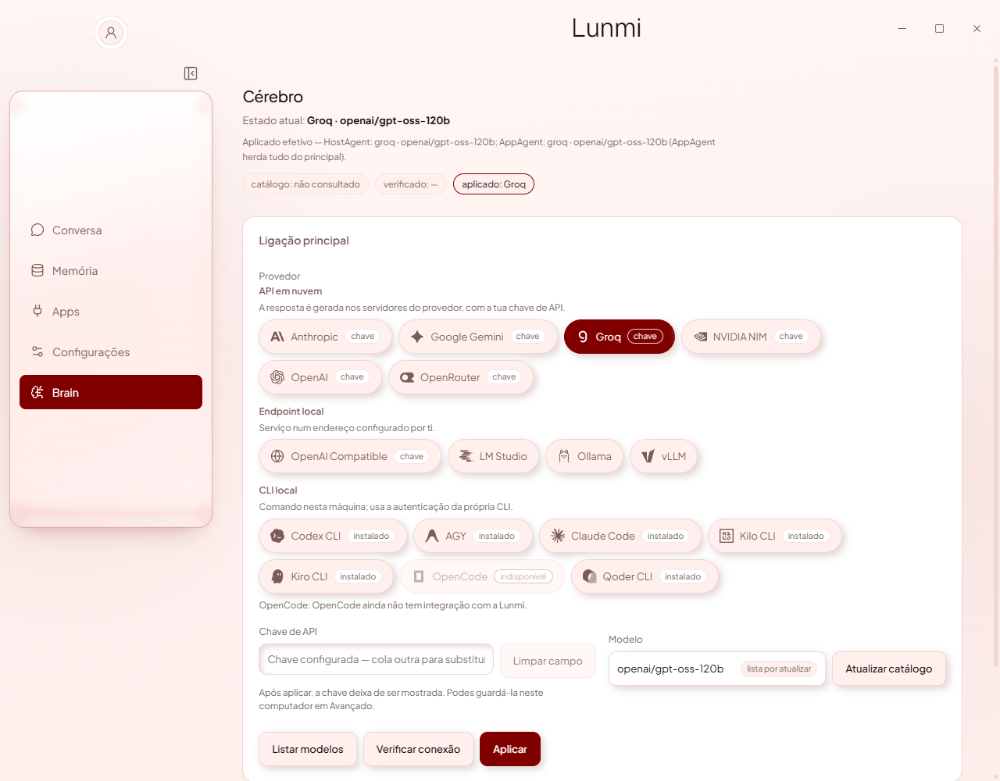

<div align="center">


# Lunmi

**Converse, organize suas ideias e execute tarefas no Windows.**

Assistente de desktop com interface Electron, backend Python e automação pelo Microsoft UFO².

[](#requisitos)
[](#começar)
[](desktop/)
[](https://github.com/MateusCosta888/Lunmi/actions/workflows/checks.yml)

[**Baixar Lunmi Alpha 6 · Windows x64**](https://github.com/MateusCosta888/Lunmi/releases/download/v0.1.0-alpha.6/Lunmi-0.1.0-alpha.6-Setup.exe)

[Instalar](#instalar-o-alpha-6) · [Executar pelo código](#começar) · [Funcionalidades](#o-que-a-lunmi-faz) · [Arquitetura](docs/ARCHITECTURE.md) · [Privacidade](SECURITY.md) · [Contribuir](CONTRIBUTING.md)

</div>

<p align="center">
  
</p>

> **Alpha 6 em teste.** Esta versão traz uma introdução que liga o Groq ou o Kiro, pesquisa web que lê as páginas, voz e ditado offline e atualização automática pelo GitHub Releases. O instalador ainda não tem certificado de editor do Windows, então o Windows pode avisar na primeira execução. Veja [a Release](https://github.com/MateusCosta888/Lunmi/releases/tag/v0.1.0-alpha.6) e [os limites de segurança](SECURITY.md).

## Instalar o Alpha 6

1. Baixe o [instalador para Windows 10/11 x64](https://github.com/MateusCosta888/Lunmi/releases/download/v0.1.0-alpha.6/Lunmi-0.1.0-alpha.6-Setup.exe) (cerca de 2,08 GB, com os modelos de voz). A instalação leva alguns minutos.
2. Execute o instalador e abra a Lunmi. O Python vem junto; você não precisa instalar Python, Node.js nem Git.
3. Na primeira abertura, a introdução ajuda a ligar um cérebro: o Groq, que é gratuito, ou o Kiro CLI. Depois, em **Brain**, você pode trocar para outra API, endpoint ou CLI com o seu próprio acesso. A Lunmi não inclui créditos nem chaves de IA.

<p align="center">
  
</p>

Quem tem o Alpha 4 ou o Alpha 5 recebe esta versão pelo atualizador. A primeira atualização para o Alpha 6 troca todos os arquivos e demora mais; as seguintes trocam só o necessário. Quem usa o Alpha 3 precisa instalar o Alpha 6 manualmente uma vez.

A Lunmi procura novas versões e baixa em segundo plano. Para instalar, vá em **Configurações → Atualizações** e escolha **Reiniciar e atualizar**. Uma tarefa ou a voz em andamento bloqueia a instalação. Histórico, memória e configurações ficam fora da pasta do programa e não se perdem.

Uma versão nova só chega quando publicamos uma Release; enviar código para `main` apenas roda os testes. O modo `run.bat` não se atualiza sozinho. [Como funcionam as atualizações](docs/UPDATES.md)

## O que a Lunmi faz

| Recurso | Como funciona |
| --- | --- |
| Chat único | Responde, pergunta quando o pedido não está claro ou usa ferramentas. A autorização e a verificação ficam no backend. |
| Resposta progressiva | O texto aparece aos poucos quando o provedor oferece streaming; nos outros, chega inteiro. |
| Conversas salvas | Histórico local, separado da memória pessoal. Dá para retomar, renomear, apagar ou abrir uma conversa temporária. |
| Pesquisa web | O cérebro decide quando pesquisar, lê as páginas e cita as fontes. Perguntas de continuação usam o contexto da conversa. |
| Brain configurável | APIs, endpoints compatíveis e CLIs locais. Os modelos disponíveis dependem do provedor. |
| Memória local | Um texto livre que você edita, com Salvar e Desfazer, aprendizado opcional e importação e exportação. |
| Gmail via Composio | Pesquisa, lê e prepara emails com a sua conta Composio. Enviar exige aprovar uma prévia. Experimental. |
| Perfil local | Nome e foto, editáveis na janela. A foto não vai para o Brain. |
| Anexos de texto | Até 4 arquivos UTF-8, 32 KiB cada e 64 KiB no total. Um pedido com anexos não autoriza ações. |
| Controle do usuário | Confirmações, perguntas, cancelamento e avisos de falha fazem parte de cada tarefa. |
| Temas | Celestial, Claro suave e Red Velvet. A opção Reduzir animações fica em Configurações → Aparência. |
| Lunmi Node | Ao fechar a janela principal, a Lunmi pode continuar na bandeja com um Node num canto da tela, com mini chat, estado das tarefas e controle de mídia do Windows (tocar, pausar, anterior, próxima). |
| Voz e ditado locais | Voz e ditado pela CPU, incluídos no instalador. Ficam desligados até você ativar; o microfone só abre quando você pede. |
| GalaxyOrb | O orb fica na conversa principal e continua lá quando chegam mensagens. |
| Atualizações pelo GitHub | Desde o Alpha 4: download automático, verificação da assinatura e instalação quando você confirma. |

Tarefas conhecidas seguem caminhos fixos; as outras passam pelos agentes do UFO². Uma ação enviada não prova que deu certo: confira o resultado e a evidência que a Lunmi mostra.

## Requisitos

Para usar o instalador, basta o Windows. Os requisitos abaixo são para rodar pelo código-fonte:

- Windows 10 ou 11, com a sessão aberta e desbloqueada.
- Python 3.11 (com Tkinter, se quiser a interface antiga).
- Node.js 24 LTS, npm e Git no terminal.
- Internet na instalação, para baixar as dependências e a versão fixa do UFO².
- Um provedor de IA. Endpoints locais e CLIs precisam ser instalados e configurados à parte.

Custos, limites e disponibilidade são do provedor que você escolher.

## Começar

No PowerShell:

```powershell
git clone https://github.com/MateusCosta888/Lunmi.git
cd Lunmi

py -3.11 -m venv .venv
.\.venv\Scripts\python.exe -m pip install -r requirements.lock
.\.venv\Scripts\python.exe install_ufo.py

cd desktop
npm ci
npm run build
cd ..

.\run.bat
```

O build cria `desktop/.runtime/Lunmi.exe`, com o nome e o ícone da Lunmi, que o `run.bat` abre. Ele depende deste checkout e não mexe no Electron instalado; não é um instalador nem um executável portátil.

`install_ufo.py` baixa e confere a versão registrada em [`ufo.lock.json`](ufo.lock.json). A pasta `vendor/` é local e fica fora do repositório. O launcher confere essa pasta antes de abrir o app.

Em **Brain**, escolha o provedor e informe a chave ou o endpoint. Quando o provedor tem catálogo, os modelos aparecem no seletor da barra de conversa.

Para configurar por variáveis de ambiente, copie [`.env.example`](.env.example) para `.env`. Esse arquivo é ignorado pelo Git, e os valores dele têm prioridade sobre os da interface.

[Guia de instalação e solução de problemas](docs/GETTING_STARTED.md)

## Um chat só, com autorização explícita

Você não precisa escolher entre conversar e executar. "Como apago uma pasta?" recebe uma explicação; "apaga a pasta X" pode usar ferramentas. Se o pedido for ambíguo, a Lunmi pergunta antes.

- Comece com tarefas pequenas e arquivos de teste.
- Leia cada pedido de confirmação antes de aceitar.
- **Parar** cancela a tarefa atual.
- Se o backend reiniciar depois de uma falha, a última instrução não é repetida.
- Mudar a Autoaprovação vale a partir da próxima tarefa.
- Enviar email sempre pede aprovação da prévia, mesmo com Autoaprovação ligada. Um envio com resultado incerto não é repetido, e o Gmail aceitar a mensagem não garante que ela chegou.

O histórico em **Conversa** guarda as conversas neste computador. Em Configurações, você pode desligar a gravação e escolher se a Lunmi abre a última conversa ou uma nova. Apagar o histórico não apaga a memória pessoal.

Em **Configurações → Segundo plano**, você escolhe se fechar a janela mantém a Lunmi aberta, e ajusta o canto, a visibilidade e o atalho do Node. **Sair**, na bandeja, fecha o programa. O mini chat usa a mesma conversa da janela principal, e confirmações sensíveis abrem na principal. Enquanto uma tarefa roda, o Node não aceita cliques nem rouba o foco; use a bandeja para voltar à janela principal.

Voz e ditado são opcionais e experimentais. Pelo código-fonte, os modelos e o runtime de áudio não vêm junto; sem eles, a interface avisa que a voz está indisponível e o chat funciona normalmente. [Limites da voz e do segundo plano](docs/GETTING_STARTED.md#node-e-segundo-plano)

## Memória e privacidade

A memória fica num banco SQLite no seu computador. No painel, ela aparece como um texto livre, **O que a Lunmi deve saber sobre ti**, que você edita e salva. Você também pode pedir no chat para a Lunmi lembrar algo. As opções **Usar memória** e **Aprender com as conversas** controlam o que entra. O histórico do chat é separado e vem ligado para conversas novas.

A memória ser local não torna a inferência privada. Instruções, trechos de memória e observações da tarefa podem ir para o provedor que você escolheu, e um endpoint local tem limites de privacidade diferentes de uma API externa.

As chaves salvas pela interface usam a proteção DPAPI do Windows. O repositório não tem banco pessoal, credenciais, logs nem exportações de memória.

[Memória: uso e limites](docs/MEMORY.md) · [Segurança e dados locais](SECURITY.md)

## A interface

### Brain no tema Red Velvet

Os provedores aparecem como botões com as suas marcas, separados em APIs, endpoints locais e CLIs. O campo de chave só aparece quando o provedor precisa de uma. O que está disponível depende do que você instalou.

<p align="center">
  
</p>

### Memória no tema Claro suave

O texto da memória é editado e salvo no próprio painel. O tema muda em **Configurações → Aparência**, na hora, sem perder o que você estava escrevendo.

<p align="center">
  
</p>

As imagens mostram a interface do Alpha 6 com um perfil de demonstração, sem dados pessoais nem credenciais.

## Estrutura

```text
app/
  brain/        Provedores, descoberta e transportes de inferência
  bridge/       Protocolo JSONL entre Electron e Python
  computer/     Ferramentas Windows e integração UFO²
  core/         Controle da tarefa e política de execução
  integrations/ Composio OAuth e ferramentas restritas de Gmail
  memory/       Persistência e recuperação de memória
  ui/           Frontend Tkinter legado
desktop/
  electron/     Processo principal, preload e supervisão do backend
  src/          Interface React, temas e componentes
  scripts/      Montagem, auditoria e aceite dos pacotes
  tests/        Testes do frontend e do protocolo
  resources/    Metadados do runtime; binários locais fora do Git
  release/      Instaladores gerados localmente, fora do Git
docs/           Guias públicos e recursos de apresentação
tests/          Regressões do backend
benchmarks/     Ferramentas locais de medição
```

[Índice dos guias](docs/README.md) · [Como as partes se conectam](docs/ARCHITECTURE.md)

Na cópia de trabalho completa, `docs/LOCAL-INDEX.md` organiza relatórios, planos e evidências por assunto. As pastas `docs/reports/`, `docs/plans/`, `logs/`, `output/`, `research/` e `Relatorio Final/` guardam esse histórico localmente e não vão para o repositório. `docs/MAPA-DE-CAMINHOS.tsv` registra onde cada arquivo reorganizado estava e onde está.

## Desenvolvimento

```powershell
.\.venv\Scripts\python.exe -m pip install -r requirements-dev.txt
.\.venv\Scripts\python.exe -m pytest -q
.\.venv\Scripts\python.exe -m mypy
.\.venv\Scripts\python.exe -m ruff check app tests

cd desktop
npm run typecheck
npm test
npm run build
```

Os testes usam fixtures e sandboxes e não validam aplicativos externos. Testar inferência real ou controle do desktop exige um ambiente próprio e o seu consentimento para os efeitos. A interface Tkinter antiga abre com `run.bat --tk` ou `run-tk.bat`.

## Limites atuais

- A automação depende do que cada aplicativo expõe por UIA/Win32 e do que dá para verificar.
- Anexos aceitam só texto e código UTF-8. Imagens, PDF e binários são recusados, e nada desse turno vira memória automaticamente.
- A pesquisa web lê páginas, mas não controla um navegador por completo. No Groq gratuito, o limite diário de tokens dá para cerca de 60 a 80 pesquisas por dia.
- O Gmail é experimental: a conexão e a leitura foram testadas numa conta de testes, e o envio só com simulações. Cada pessoa usa a própria conta Composio e Gmail, com os limites desses serviços.
- A distribuição é alpha, só Windows x64, sem certificado Authenticode. As atualizações exigem assinatura Ed25519 válida. Faltam testes em outras máquinas, com todos os provedores e com vários monitores e escalas; não há versão para macOS ou Linux.
- Algumas dependências upstream são antigas; os avisos conhecidos estão em [Segurança](SECURITY.md#dependências-upstream).

## Créditos e licenças

A Lunmi usa [Microsoft UFO²](https://github.com/microsoft/UFO), Electron, React e outros projetos. Avisos de fontes, ícones e referências visuais estão em [THIRD_PARTY_NOTICES.md](THIRD_PARTY_NOTICES.md).

O código próprio da Lunmi ainda não tem licença definida. A licença de uma dependência não vale para o projeto inteiro, e os avisos e restrições de terceiros continuam valendo.
