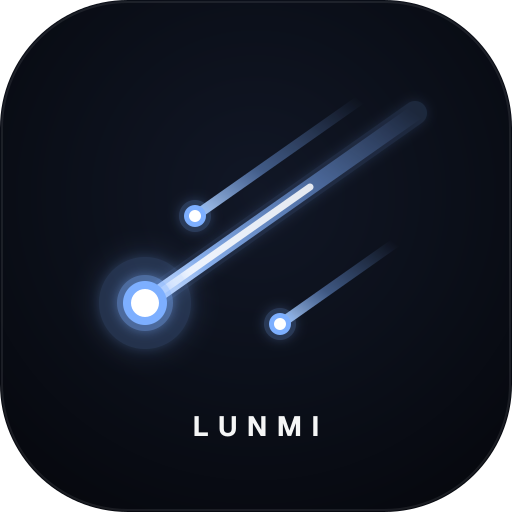
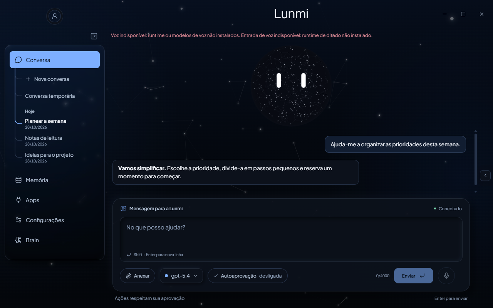
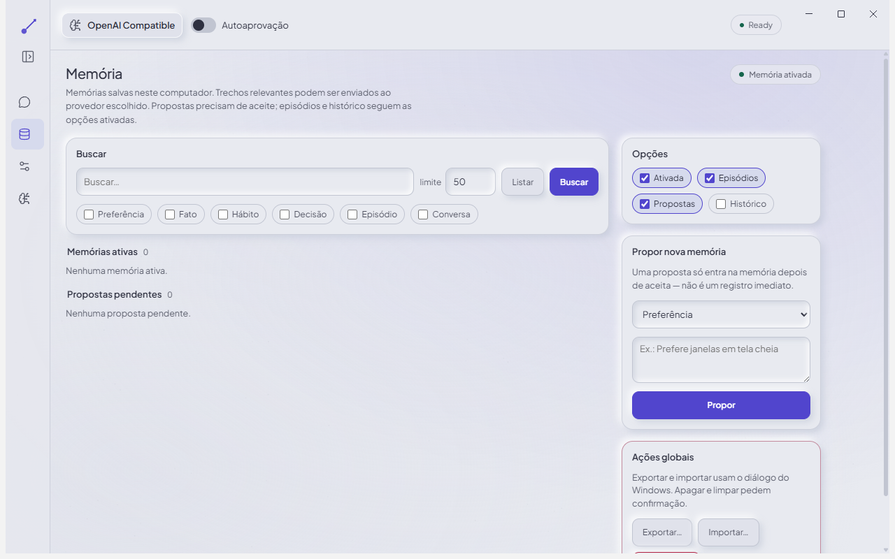

<div align="center">



# Lunmi

**Converse, organize suas ideias e execute tarefas no Windows.**

Um assistente de desktop com interface Electron, backend Python e automação assistida pelo Microsoft UFO².

[](#requisitos)
[](#começar)
[](desktop/)
[](https://github.com/MateusCosta888/Lunmi/actions/workflows/checks.yml)

[Começar](#começar) · [Funcionalidades](#o-que-a-lunmi-faz) · [Arquitetura](docs/ARCHITECTURE.md) · [Privacidade](SECURITY.md) · [Contribuir](CONTRIBUTING.md)

</div>

<p align="center">
  
</p>

> **Em desenvolvimento.** A Lunmi funciona a partir do código-fonte e tem um instalador alpha Windows x64 para testes. Ainda não há instalador assinado, atualização automática ou garantia de automação universal.

## O que a Lunmi faz

| Recurso | Comportamento |
| --- | --- |
| **Chat único** | Responde, pede esclarecimento ou utiliza ferramentas conforme o pedido, mantendo autorização e verificação no backend. |
| **Resposta progressiva** | Mostra texto incremental nos transportes que oferecem streaming real. Transportes sem essa capacidade entregam a resposta completa. |
| **Conversas guardadas** | Histórico local separado da memória pessoal; retomar, renomear, apagar e conversar temporariamente. |
| **Pesquisa web** | Pesquisa configurável com fontes e metadados; disponibilidade e profundidade dependem do motor e do Brain. |
| **Brain configurável** | Usa APIs, endpoints compatíveis e CLIs locais suportados. O catálogo depende do provedor conectado. |
| **Memória local V2** | Documento editável com Guardar/Desfazer, aprendizagem opcional e gestão detalhada de episódios, propostas legadas e importação/exportação. |
| **Gmail via Composio** | Liga a conta Composio do próprio utilizador para pesquisar, ler e preparar emails. Envio exige uma prévia com aprovação manual. Integração experimental. |
| **Perfil local** | Nome de tratamento e foto, editáveis na própria janela. A foto não vai ao Brain. |
| **Anexos de texto** | Até 4 arquivos UTF-8, 32 KiB por arquivo e 64 KiB no total; o turno com anexos não autoriza ações. |
| **Controle do usuário** | Confirmações, perguntas, cancelamento e indicação de falhas fazem parte da execução. |
| **Interface adaptável** | Temas Celestial, Claro suave e Red Velvet, laterais com vidro, navegação recolhível e compositor multilinha com seleção de modelo. |
| **Lunmi Node** | Ao fechar a principal, pode continuar na bandeja com um Node num canto superior. Abre um mini chat sincronizado e mostra atividade/atenção. Fica passivo durante tarefas para não intercetar cliques. |
| **Saída de voz local** | Controlos para testar, ouvir a última resposta elegível e parar a fala. Requer runtime e modelos preparados separadamente; começa desligada. Captura de microfone ainda não está disponível. |
| **GalaxyOrb** | Presença visual persistente na conversa principal, preservada quando chegam mensagens. |

A execução combina caminhos determinísticos para tarefas reconhecidas e agentes UFO² para as demais. Um despacho de ação não prova sucesso: confira o resultado e a evidência apresentados.

## Requisitos

Os requisitos abaixo são para executar pelo código-fonte. O instalador alpha inclui o runtime Python e as dependências; cada testador configura o seu próprio Brain.

- **Windows 10 ou 11**, com a sessão de desktop aberta e desbloqueada.
- **Python 3.11**, com Tkinter para o frontend legado opcional.
- **Node.js 24 LTS**, npm e Git disponíveis no terminal.
- Internet na instalação para baixar dependências e a revisão fixada do UFO².
- Um provedor de IA para os fluxos com inferência. Endpoints locais e CLIs precisam estar instalados/configurados separadamente.

Custos, limites e disponibilidade pertencem ao provedor escolhido. A Lunmi não inclui créditos nem chaves de API.

## Começar

No PowerShell:

```powershell
git clone https://github.com/MateusCosta888/Lunmi.git
cd Lunmi

py -3.11 -m venv .venv
.\.venv\Scripts\python.exe -m pip install -r requirements.lock
.\.venv\Scripts\python.exe install_ufo.py

cd desktop
npm ci
npm run build
cd ..

.\run.bat
```

No Windows, o build prepara um runtime local `desktop/.runtime/Lunmi.exe`, com nome e ícone da Lunmi. Ele é iniciado por `run.bat` e não modifica o Electron instalado. Esse runtime depende deste checkout; não é um instalador ou executável portátil independente.

`install_ufo.py` baixa e confere a revisão registrada em [`ufo.lock.json`](ufo.lock.json). `vendor/` é local e não faz parte deste repositório. O launcher também verifica esse checkout antes de abrir o app.

Em **Brain**, escolha o provedor e configure credenciais ou endpoint. Quando disponível, o catálogo de modelos aparece no seletor da própria barra de conversa.

Para configuração por ambiente, copie [`.env.example`](.env.example) para `.env`. O arquivo real é local e ignorado pelo Git. Valores explícitos do ambiente têm prioridade sobre os da interface.

[Guia de instalação e solução de problemas →](docs/GETTING_STARTED.md)

## Um chat, autorização explícita

Na interface atual não é preciso escolher Conversar ou Executar. Uma pergunta como "Como apago uma pasta?" deve produzir uma explicação; um pedido direto de operação pode utilizar ferramentas. Pedidos ambíguos exigem esclarecimento. Os modos legados continuam no protocolo para compatibilidade.

- Comece com uma tarefa pequena e arquivos próprios de teste.
- Leia os pedidos de confirmação antes de aceitar.
- **Parar** solicita o cancelamento da tarefa atual.
- Reiniciar um backend falhado não repete automaticamente a instrução anterior.
- A Autoaprovação mantém o comportamento existente: a alteração se destina à próxima tarefa, sem trocar a política de uma tarefa em andamento.
- O envio de email exige aprovação manual da prévia, mesmo com Autoaprovação ligada. Um resultado incerto não é repetido automaticamente; aceitação pelo Gmail não comprova entrega ao destinatário.

O painel de tarefas recentes mostra a sessão atual. O histórico sob **Conversa** guarda as
novas conversas neste computador, permite continuá-las e oferece conversas temporárias.
Em Configurações, pode desativar a gravação e escolher entre retomar a última conversa ou
começar uma nova. Apagar histórico não apaga factos da memória pessoal.

Em **Configurações → Segundo plano**, escolha se fechar a janela mantém a Lunmi em execução. O Node tem opções de canto, visibilidade, recolhimento, atividade e atalho. **Sair** na bandeja termina a aplicação. O mini chat partilha a conversa atual; confirmações sensíveis são abertas na principal. Durante uma tarefa em execução, o Node não aceita interação nem rouba o foco; use a bandeja para restaurar a principal se precisar intervir.

A saída de voz e o ditado são opcionais e experimentais. O checkout não inclui os modelos
nem instala um runtime de áudio automaticamente. Sem esses recursos, a interface indica
indisponibilidade e o chat continua a funcionar. O microfone é acionado pelo utilizador;
não há escuta contínua. Veja [os limites da voz e do modo residente](docs/GETTING_STARTED.md#node-e-segundo-plano).

## Memória e privacidade

As memórias ficam em SQLite local. O painel apresenta um documento de texto livre: **O que a Lunmi deve saber sobre ti**. É possível editar e guardar, pedir para lembrar algo no chat e permitir aprendizagem de declarações claras em conversas. As opções **Usar memória** e **Aprender com as conversas** controlam esse comportamento. Propostas legadas continuam sujeitas a aceite; episódios e o histórico legado da memória têm opções próprias. O histórico do chat é separado e começa ativado para novas conversas.

**Memória local não significa inferência privada.** Instruções, contexto recuperado e observações necessárias à execução podem ser enviados ao provedor escolhido. Um endpoint local e uma API externa têm fronteiras de privacidade diferentes.

Chaves lembradas pela interface usam DPAPI do Windows. O repositório não contém banco pessoal, credenciais, logs de execução ou exportações de memória.

[Memória: uso e limites →](docs/MEMORY.md) · [Segurança e dados locais →](SECURITY.md)

## Claro suave

Troque o tema em **Configurações → Aparência**, sem reiniciar ou apagar o rascunho. A escolha é lembrada na próxima abertura.

<p align="center">
  
</p>

As imagens mostram o aplicativo real em ambiente de demonstração, sem dados pessoais. Não representam modelos ou integrações adicionais disponíveis por padrão.

## Estrutura

```text
app/
  brain/        Provedores, descoberta e transportes de inferência
  bridge/       Protocolo JSONL entre Electron e Python
  computer/     Ferramentas Windows e integração UFO²
  core/         Controle da tarefa e política de execução
  integrations/ Composio OAuth e ferramentas restritas de Gmail
  memory/       Persistência e recuperação de memória
  ui/           Frontend Tkinter legado
desktop/
  electron/     Processo principal, preload e supervisão do backend
  src/          Interface React, temas e componentes
  scripts/      Montagem, auditoria e aceite dos pacotes
  tests/        Testes do frontend e do protocolo
  resources/    Metadados do runtime; binários locais fora do Git
  release/      Instaladores gerados localmente, fora do Git
docs/           Guias públicos e recursos de apresentação
tests/          Regressões do backend
benchmarks/     Ferramentas locais de medição
```

[Índice dos guias →](docs/README.md)

Na cópia completa de trabalho, `docs/LOCAL-INDEX.md` organiza os relatórios por assunto, planos, investigação e evidências. `docs/reports/`, `docs/plans/`, `logs/`, `output/`, `research/` e `Relatorio Final/` conservam o histórico local; esses materiais não são publicados em bloco no repositório. `docs/MAPA-DE-CAMINHOS.tsv` regista a localização anterior e atual dos ficheiros reorganizados.

[Como as partes se conectam →](docs/ARCHITECTURE.md)

## Desenvolvimento

```powershell
.\.venv\Scripts\python.exe -m pip install -r requirements-dev.txt
.\.venv\Scripts\python.exe -m pytest -q
.\.venv\Scripts\python.exe -m mypy
.\.venv\Scripts\python.exe -m ruff check app tests

cd desktop
npm run typecheck
npm test
npm run build
```

Os testes usam fixtures e sandboxes; não certificam qualquer aplicativo externo. Inferência real e controle do desktop exigem ambiente próprio e consentimento para seus efeitos. O frontend Tkinter continua disponível com `run.bat --tk` ou `run-tk.bat`.

## Limites atuais

- Automação depende do que os aplicativos expõem por UIA/Win32 e da verificação disponível.
- Anexos aceitam texto/código UTF-8. Imagens, PDF e binários são recusados; anexos e respostas desse turno não viram memória automática.
- Streaming depende da capacidade do transporte. Voz e ditado requerem runtimes externos preparados; pesquisa web não equivale a controlo completo de um navegador.
- Gmail é experimental: a ligação e a leitura reais foram exercitadas numa conta de testes; o diálogo e as confirmações de envio foram testados com simulações. Envio/entrega reais, todos os formatos MIME e todas as combinações de modelos não estão certificados. Cada utilizador usa a sua conta Composio e Gmail; os limites desses serviços continuam a aplicar-se.
- A distribuição empacotada está em alpha Windows x64, sem assinatura ou atualização automática. Outra máquina/VM e provedores reais ainda precisam de validação; não há suporte a macOS/Linux ou certificação geral de múltiplos monitores e DPIs.
- Há dependências upstream legadas; avisos conhecidos e triagem estão em [Segurança](SECURITY.md#dependências-upstream).

## Créditos e licenças

A Lunmi integra [Microsoft UFO²](https://github.com/microsoft/UFO), Electron, React e outros projetos. Avisos de fontes, ícones e referências visuais: [THIRD_PARTY_NOTICES.md](THIRD_PARTY_NOTICES.md).

Uma licença geral para o código próprio da Lunmi ainda não foi definida. Não presuma que permissões de uma dependência se estendam ao projeto inteiro; os avisos e restrições de terceiros continuam aplicáveis.
